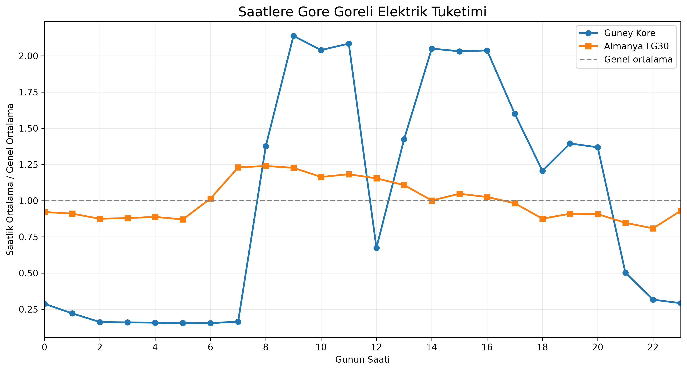
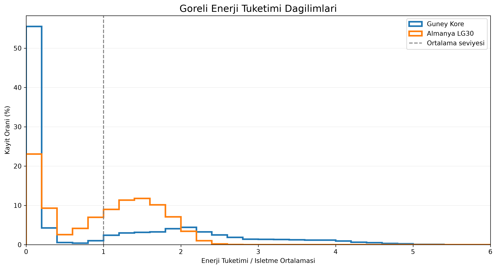
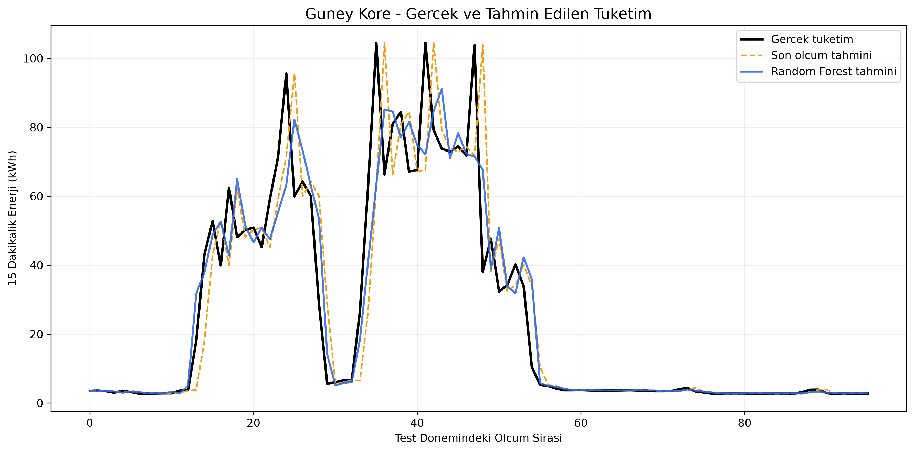

# Endüstriyel Enerji Tüketimi Analizi ve Tahminleme

## Proje Hakkında

Bu projede Güney Kore ve Almanya'daki iki farklı sanayi
işletmesinin elektrik tüketimi Python ile analiz edilmiştir.

Çalışmanın amacı; enerji tüketim davranışlarını incelemek,
işletmeleri karşılaştırmak ve makine öğrenmesi yöntemleriyle
kısa vadeli enerji tüketimi tahminleri oluşturmaktır.

## Analizden Örnek Görseller

### Saatlik Enerji Tüketimi

### Enerji Tüketimi Dağılımı

### Güney Kore - Tahmin Sonuçları

## Kullanılan Teknolojiler

- Python
- Pandas ve NumPy
- Matplotlib
- Scikit-learn
- VS Code
- Git ve GitHub

## Veri Setleri

**1. Güney Kore - Steel Industry Energy Consumption**

- 2018 yılına ait ölçümler
- 35.040 kayıt
- 15 dakikalık enerji tüketimi verileri

**2. Almanya - Industrial Load Profiles**

- 2017 yılına ait ölçümler
- 30 sanayi işletmesine ait elektrik yükü verileri
- Karşılaştırma için LG 30 işletmesi seçilmiştir.

Veri kaynaklarının bağlantıları ve kullanım koşulları
ayrıca belgelenecektir.

## Veri Temizleme

Python ve Pandas kullanılarak:

- Eksik değerler kontrol edildi.
- Tekrarlanan kayıtlar incelendi.
- Tarih biçimleri düzenlendi.
- Güney Kore verisinde 365 tarih etiketi düzeltildi.
- Almanya verisinde 100 tamamen boş satır çıkarıldı.
- Dört özel saat kaydı korundu.
- Almanya'daki ortalama güç ölçümleri kWh'ye dönüştürüldü.

Temizleme sonrasında:

| İşletme | Kullanılabilir kayıt |
|---|---:|
| Güney Kore | 35.040 |
| Almanya LG 30 | 34.944 |

## İstatistiksel Analiz

İki işletme için aşağıdaki analizler gerçekleştirilmiştir:

- Ortalama, medyan ve mod
- Varyans ve standart sapma
- Değişim katsayısı
- Frekans analizi
- Histogram
- Kutu grafiği (Boxplot)
- Saatlik ve haftalık tüketim analizi

## Makine Öğrenmesi

Enerji tüketimini 15 dakika ileriye dönük tahmin etmek
amacıyla dört yöntem karşılaştırılmıştır:

1. Son ölçüm yöntemi
2. 96 kayıt önceki ölçüm yöntemi
3. Linear Regression
4. Random Forest Regressor

### Random Forest Test Sonuçları

| Metrik | Güney Kore | Almanya LG 30 |
|---|---:|---:|
| MAE (kWh) | 3,904 | 1,721 |
| RMSE (kWh) | 8,426 | 2,778 |
| R² | 0,928 | 0,920 |

Random Forest, incelenen test dönemlerinde her iki
işletmede de en düşük tahmin hatalarını üretmiştir.

Son ölçüm yöntemine göre MAE iyileşmesi:

- Güney Kore: %28,3
- Almanya LG 30: %4,6

## Proje Dosyaları

- `01_veri_inceleme.py`: İlk veri incelemesi
- `04_veri_temizleme.py`: Veri temizleme işlemleri
- `05_betimsel_analiz.py`: İstatistiksel analiz
- `06_frekans_analizi.py`: Frekans tabloları
- `07_gorsellestirme.py`: Karşılaştırmalı grafikler
- `08_histogram.py`: Histogram analizi
- `09_boxplot.py`: Kutu grafiği
- `10_saatlik_analiz.py`: Saatlik tüketim analizi
- `11_haftalik_analiz.py`: Haftalık tüketim analizi
- `12_baslangic_tahminleri.py`: Basit tahminler
- `13_regresyon_modelleri.py`: Regresyon modelleri
- `14_tahmin_grafikleri.py`: Tahmin grafikleri
- `15_temizlik_kaniti.py`: Temizleme doğrulaması

Analiz grafikleri `outputs/grafikler/` klasöründedir.

## Çalışmanın Sınırları

İki veri seti farklı yıllara ve işletmelere aittir.
Bu nedenle çalışma, enerji verimliliğini doğrudan
karşılaştırmaktan ziyade tüketim örüntülerine ve
tahmin performansına odaklanmaktadır.

Ham veri dosyaları GitHub deposuna eklenmemiştir.

## Veri Kaynakları

### 1. Güney Kore - Steel Industry Energy Consumption

Kaynak: UCI Machine Learning Repository

https://archive.ics.uci.edu/dataset/851/steel+industry+energy+consumption

Dosya: Steel_industry_data.csv

Bu veri seti, Güney Kore'de bulunan bir çelik
işletmesinin 2018 yılı elektrik tüketimi verilerini içerir.

### 2. Almanya - Industrial Load Profiles

Kaynak: Zenodo - Fritz Braeuer

https://zenodo.org/records/3899018

Dosya: LoadProfile_30IPs_2017.csv

Bu veri seti, Almanya'daki 30 sanayi işletmesinin
2017 yılı elektrik yükü ölçümlerini içerir.

Analiz için LG 30 işletmesi seçilmiştir.

## Projeyi Çalıştırma

1. Bu depoyu bilgisayarınıza indirin.
2. Python kütüphanelerini yükleyin:

   python -m pip install -r requirements.txt

3. Ana proje klasöründe data adlı klasör oluşturun.
4. Kaynak bağlantılarından iki CSV dosyasını indirin.
5. Dosyaları data klasörüne yerleştirin.
6. Python analiz dosyalarını numara sırasına göre çalıştırın.

Örnek:

   python 01_veri_inceleme.py
   python 04_veri_temizleme.py
   python 05_betimsel_analiz.py

Grafikler outputs/grafikler klasörüne kaydedilir.

Not: İki veri seti farklı yıllara ve işletmelere aittir.
Bu çalışma doğrudan enerji verimliliği sıralaması değil,
tüketim davranışı ve tahminleme karşılaştırmasıdır.
